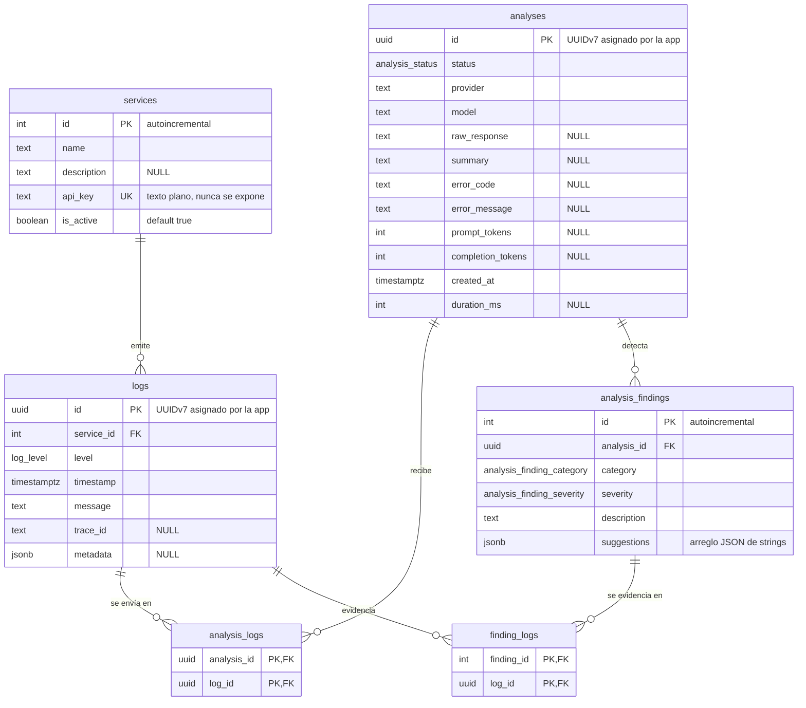

# Modelo de datos (MER: modelo entidad-relación)

La fuente de verdad es [`db/schema.prisma`](../db/schema.prisma) y las migraciones de [`db/migrations`](../db/migrations); si este documento difiere, prevalecen ellas.

`docs/MER.jpg` es la vista conceptual del modelo, sin tablas intermedias N:M, claves foráneas ni índices, que se detallan aquí. Las decisiones detrás del modelo están en [Modelo de datos](../ARCHITECTURE.md#modelo-de-datos).

## Diagrama

## Tablas

Todas las claves foráneas tienen `ON UPDATE CASCADE`. Los ids UUIDv7 son columnas `uuid` nativas, sin default en la base: los asigna la aplicación.

### `services`

| Columna       | Tipo      | Nulo | Default       | Clave | Notas                                                                                            |
| ------------- | --------- | ---- | ------------- | ----- | ------------------------------------------------------------------------------------------------ |
| `id`          | `int4`    | No   | autoincrement | PK    | Sale por la API como `serviceId`; no da acceso: se autentica con `api_key`.                      |
| `name`        | `text`    | No   | -             | -     | No es único.                                                                                     |
| `description` | `text`    | Sí   | -             | -     |                                                                                                  |
| `api_key`     | `text`    | No   | -             | UK    | [Texto plano](../ARCHITECTURE.md#api-key-por-servicio-guardada-en-texto-plano). Nunca se expone. |
| `is_active`   | `boolean` | No   | `true`        | -     | Una key inactiva se rechaza igual que una desconocida.                                           |

### `logs`

| Columna      | Tipo             | Nulo | Default | Clave                                    | Notas                                           |
| ------------ | ---------------- | ---- | ------- | ---------------------------------------- | ----------------------------------------------- |
| `id`         | `uuid`           | No   | -       | PK                                       | UUIDv7: codifica el momento de inserción.       |
| `service_id` | `int4`           | No   | -       | FK -> `services.id` (ON DELETE RESTRICT) | El servicio sale de la API key, nunca del body. |
| `level`      | `log_level`      | No   | -       | -                                        | Ver [Enums](#enums).                            |
| `timestamp`  | `timestamptz(3)` | No   | -       | -                                        | Hora que informa el servicio.                   |
| `message`    | `text`           | No   | -       | -                                        |                                                 |
| `trace_id`   | `text`           | Sí   | -       | -                                        |                                                 |
| `metadata`   | `jsonb`          | Sí   | -       | -                                        | Objeto JSON; se omite en vez de guardar `null`. |

### `analyses`

| Columna             | Tipo              | Nulo | Default | Clave | Notas                                                                                                                                                        |
| ------------------- | ----------------- | ---- | ------- | ----- | ------------------------------------------------------------------------------------------------------------------------------------------------------------ |
| `id`                | `uuid`            | No   | -       | PK    | UUIDv7.                                                                                                                                                      |
| `status`            | `analysis_status` | No   | -       | -     | Ver [Enums](#enums). Solo uno puede estar en `PROCESSING` (ver [Un solo análisis en curso a la vez](../ARCHITECTURE.md#un-solo-análisis-en-curso-a-la-vez)). |
| `provider`          | `text`            | No   | -       | -     | Proveedor del LLM (`mock` o `gemini`).                                                                                                                       |
| `model`             | `text`            | No   | -       | -     |                                                                                                                                                              |
| `raw_response`      | `text`            | Sí   | -       | -     | Respuesta cruda del LLM. Nunca se expone.                                                                                                                    |
| `summary`           | `text`            | Sí   | -       | -     |                                                                                                                                                              |
| `error_code`        | `text`            | Sí   | -       | -     | Texto en la base; el conjunto cerrado vive en el dominio (`AnalysisErrorCode`).                                                                              |
| `error_message`     | `text`            | Sí   | -       | -     |                                                                                                                                                              |
| `prompt_tokens`     | `int4`            | Sí   | -       | -     | `Int` y no `Long`, ver [Tipos y columnas derivadas](../ARCHITECTURE.md#tipos-y-columnas-derivadas).                                                          |
| `completion_tokens` | `int4`            | Sí   | -       | -     |                                                                                                                                                              |
| `created_at`        | `timestamptz(3)`  | No   | -       | -     |                                                                                                                                                              |
| `duration_ms`       | `int4`            | Sí   | -       | -     | `NULL` mientras está en `PROCESSING` y en los análisis cerrados por la recuperación al arrancar.                                                             |

### `analysis_logs`

Relación N:M entre un análisis y los logs que se enviaron al LLM.

| Columna       | Tipo   | Nulo | Default | Clave                                       | Notas                                |
| ------------- | ------ | ---- | ------- | ------------------------------------------- | ------------------------------------ |
| `analysis_id` | `uuid` | No   | -       | PK, FK -> `analyses.id` (ON DELETE CASCADE) | Borrar el análisis borra sus filas.  |
| `log_id`      | `uuid` | No   | -       | PK, FK -> `logs.id` (ON DELETE RESTRICT)    | Un log analizado no se puede borrar. |

### `analysis_findings`

| Columna       | Tipo                        | Nulo | Default       | Clave                                   | Notas                                               |
| ------------- | --------------------------- | ---- | ------------- | --------------------------------------- | --------------------------------------------------- |
| `id`          | `int4`                      | No   | autoincrement | PK                                      |                                                     |
| `analysis_id` | `uuid`                      | No   | -             | FK -> `analyses.id` (ON DELETE CASCADE) | Composición: el hallazgo no existe sin su análisis. |
| `category`    | `analysis_finding_category` | No   | -             | -                                       | Ver [Enums](#enums).                                |
| `severity`    | `analysis_finding_severity` | No   | -             | -                                       | Ver [Enums](#enums).                                |
| `description` | `text`                      | No   | -             | -                                       |                                                     |
| `suggestions` | `jsonb`                     | No   | -             | -                                       | Arreglo JSON de strings.                            |

### `finding_logs`

Relación N:M entre un hallazgo y los logs que lo evidencian.

| Columna      | Tipo   | Nulo | Default | Clave                                                | Notas |
| ------------ | ------ | ---- | ------- | ---------------------------------------------------- | ----- |
| `finding_id` | `int4` | No   | -       | PK, FK -> `analysis_findings.id` (ON DELETE CASCADE) |       |
| `log_id`     | `uuid` | No   | -       | PK, FK -> `logs.id` (ON DELETE RESTRICT)             |       |

## Enums

| Enum (tipo en la base)      | Valores                                                                                                                                                                                                    |
| --------------------------- | ---------------------------------------------------------------------------------------------------------------------------------------------------------------------------------------------------------- |
| `log_level`                 | `DEBUG`, `INFO`, `WARN`, `ERROR`, `FATAL`                                                                                                                                                                  |
| `analysis_status`           | `PROCESSING`, `COMPLETED`, `FAILED`                                                                                                                                                                        |
| `analysis_finding_category` | `DATABASE`, `NETWORK`, `TIMEOUT`, `EXTERNAL_DEPENDENCY`, `AUTHENTICATION`, `VALIDATION`, `RESOURCE_EXHAUSTION`, `PERFORMANCE`, `CONFIGURATION`, `APPLICATION_ERROR`, `SECURITY`, `DATA_INTEGRITY`, `OTHER` |
| `analysis_finding_severity` | `LOW`, `MEDIUM`, `HIGH`, `CRITICAL`                                                                                                                                                                        |

El código de error de un análisis (`analyses.error_code`) no es un enum de la base: es `text`.

## Índices y restricciones

Las consultas que justifican cada índice están en [Índices](../ARCHITECTURE.md#índices).

| Tabla               | Nombre                              | Columnas                               | Tipo          |
| ------------------- | ----------------------------------- | -------------------------------------- | ------------- |
| `services`          | `services_pkey`                     | `id`                                   | PK            |
| `services`          | `services_api_key_key`              | `api_key`                              | Único         |
| `logs`              | `logs_pkey`                         | `id`                                   | PK            |
| `logs`              | `logs_timestamp_id_idx`             | `timestamp DESC, id DESC`              | Índice        |
| `logs`              | `logs_service_id_timestamp_id_idx`  | `service_id, timestamp DESC, id DESC`  | Índice        |
| `logs`              | `logs_level_timestamp_idx`          | `level, timestamp DESC`                | Índice        |
| `logs`              | `logs_trace_id_idx`                 | `trace_id`                             | Índice        |
| `analyses`          | `analyses_pkey`                     | `id`                                   | PK            |
| `analyses`          | `analyses_single_processing`        | `status` `WHERE status = 'PROCESSING'` | Único parcial |
| `analysis_logs`     | `analysis_logs_pkey`                | `analysis_id, log_id`                  | PK compuesta  |
| `analysis_logs`     | `analysis_logs_log_id_idx`          | `log_id`                               | Índice        |
| `analysis_findings` | `analysis_findings_pkey`            | `id`                                   | PK            |
| `analysis_findings` | `analysis_findings_analysis_id_idx` | `analysis_id`                          | Índice        |
| `finding_logs`      | `finding_logs_pkey`                 | `finding_id, log_id`                   | PK compuesta  |

No hay restricciones `CHECK` en las migraciones: los dominios cerrados se resuelven con enums de Postgres.
